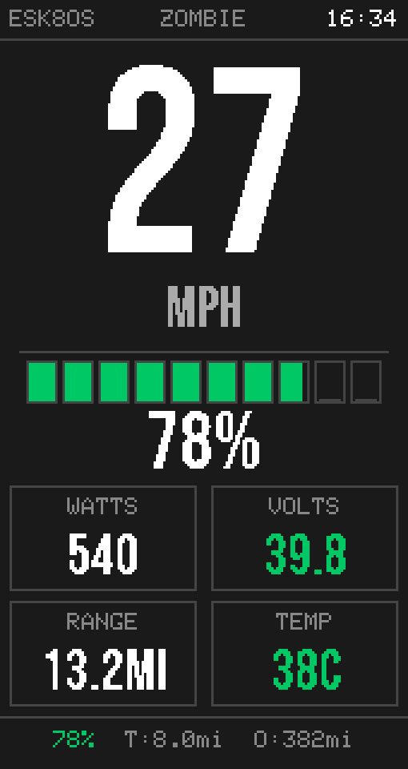

# EVEE · ESK8OS

Open telemetry for VESC-based personal electric vehicles. ESK8OS is the
electric-skateboard edition: a dashboard computer that plugs into your ESC's
COMM port, reads it a dozen times a second, and turns that into live screens,
honest battery math, ride logging, and a phone app.

**Read-only by design** — the only thing this firmware ever writes to the ESC
is the odometer. It cannot command current, duty, or cutoffs, so a dashboard
fault can never become a ride fault.

<p align="center">
  
</p>

**Site & manual:** [evee.zombie.digital](https://evee.zombie.digital) ·
[wiring / install manual](https://evee.zombie.digital/manual.html) ·
[release feed](https://apps.zombie.digital/downloads/esk8os-firmware/latest.json) ·
[companion app](https://github.com/joenilan/esk8os_mobile)

## Highlights

- **One firmware, three kinds of glass** — full color dashboard, 0.91" OLED
  glance display, or fully headless with the phone as the UI. Less display
  simply moves more of the picture to the app.
- **Self-configuring** — three config tiers: *rider override → VESC-read base →
  neutral default*. On first link the board reads the ESC's own configuration
  (cells, pack Ah, cutoff voltages, motor poles, gearing, wheel size) and uses
  it as ground truth; anything you change is kept as an explicit override. The
  `cfg` console command and the app show the provenance of every value.
- **Dual VESC over CAN** — the second ESC is auto-detected; per-motor currents
  and temps, aggregated power and energy.
- **Honest battery math** — sag-compensated charge, learned pack resistance and
  consumption, qualified pack-energy modeling, and range that predicts the
  *loaded* cutoff rather than presenting a voltage guess as battery health.
- **Black-box ride logs** — 1 Hz CSV per session on flash (volts, amps, temps,
  faults, per-motor split, BMS pack + per-cell detail) with link-loss and
  voltage-collapse events flushed the instant they happen. Retention is
  byte-budgeted: the newest rides are kept while ~700 KB stays free, and bench
  boots can never rotate real ride data away. Parked power-downs are logged as
  `powerdown`, distinct from a riding pack disconnect (`vcollapse`).
- **Companion app** — BLE telemetry at 5 Hz, GPS ride recording with the board
  as the source of truth, settings with base-vs-override visibility, remote
  face/page control for buttonless boards.
- **VESC Tool bridge** — configure your ESC wirelessly through the board
  (desktop over WiFi-TCP, mobile over BLE). Credentials are per-device and
  shown on screen.
- **OTA updates + log export** — the board raises its own AP and serves logs
  and a firmware updater at `http://192.168.4.1`.
- **Eight themes**, four HUD faces, screensaver with pairing code, serial
  console for everything.

## Hardware & wiring

Full wiring guide (VESC COMM pinout, OLED add-on, which USB port, cautions):
**[the manual](https://evee.zombie.digital/manual.html)**. The short version —
four wires to a VESC COMM port:

| VESC COMM | EVEE board |
|---|---|
| 5V | 5V (the ESC powers the board) |
| GND | GND |
| TX | GPIO 18 (board RX) |
| RX | GPIO 17 (board TX) |

UART app enabled in VESC Tool ("PPM and UART" keeps a PPM remote working),
baud 115200. ⚠ **One 5V source at a time** — never USB and vehicle power
together.

## Build & flash

Uses [PlatformIO](https://platformio.org/):

On Linux, install the host tools in a user-owned virtual environment:

```bash
python3 -m venv ~/.local/share/esk8os-platformio
~/.local/share/esk8os-platformio/bin/python -m pip install -r requirements-dev.txt
./scripts/piow run -e tdisplay_s3_bms        # compile only; no device changes
```

`scripts/piow` runs from this repository regardless of the current directory.
Set `EVEE_PIO_VENV` to use another virtual environment. Python tools such as
`preview.py` and `scripts/archive_sessions.py` can use that environment's Python.
The ESP32 platform is pinned to 6.12.0 (Arduino 2.0.17); upgrading to Arduino 3
requires a deliberate compatibility pass. Core library versions match the
existing checkout's dependencies. The first build downloads Linux toolchains;
copied Windows build caches are not usable on Linux.

The Android companion is a separate Flutter project at `../esk8os_mobile`.
Its `AGENTS.md`, `HANDOFF.md`, and `DEVELOPMENT_PHONE.md` cover app development,
release signing, and preserving ride data during phone updates.

Display hardware and BMS driver are independent choices. The currently
supported driver is **Daly Smart BMS (UART K BLE)**. Other brands can be added
through hardware-validated community PRs; BMS support does not imply universal
compatibility. The current release matrix therefore contains six combinations:

| Hardware | Without BMS | With Daly BMS over BLE |
|---|---|---|
| LilyGO T-Display-S3 (TFT) | `tdisplay_s3_ride_release` | `tdisplay_s3_bms` |
| Generic ESP32-S3 + SSD1306 (128×32 OLED) | `esp32s3_oled_i2c_usb` | `esp32s3_oled_i2c_bms_usb` |
| Generic ESP32-S3, no display | `esp32s3_headless_usb` | `esp32s3_headless_bms_usb` |

The TFT Daly build keeps USB serial enabled, matching the rider's working
build. The ordinary TFT ride build disables USB CDC; use
`tdisplay_s3_debug_usb` for non-BMS TFT development with a serial console.
Generic OLED/headless variants keep USB serial in both cases. Touch and EVEE
Link experiments remain separate environments outside this release matrix.

**BMS setup (selection from firmware 0.12.3+, explicit driver type from 0.12.4):** each ESP32 remembers its own BMS. In the
Android app, connect to EVEE, open **Settings -> BMS setup -> Find my BMS**,
and confirm the module attached to your battery. Turn demo mode off for live
monitoring. Selection survives restarts; **Forget selected BMS** clears it.
Stop the vehicle and exit bridge mode before changing the selection.

Fresh devices start with no BMS selected and do not connect to nearby packs
automatically. Existing boards upgrading from the old compiled-in address also
need this one-time selection. USB fallback: `bms target <MAC>`, `bms forget`.
Support is for the verified UART K BLE service, not every Daly protocol. The
no-BMS builds do not start the Daly client and preserve a saved selection.

`wokwi-simulator` targets a generic ESP32 + ILI9341 stand-in with simulated
telemetry; it is not a hardware release download.

Build and stage the complete six-artifact release without uploading:

```bash
~/.local/share/esk8os-platformio/bin/python scripts/publish_release.py --dry-run --require-clean
python3 -m unittest discover -s tests -v
```

This producer stages **candidate** metadata with hardware validation pending;
its retired live-upload/Astro path is disabled. `--require-clean` verifies a
committed tree, detects changes during the build and rejects images whose
embedded identity does not match that clean commit. Stable publication belongs
to the separate website process after hardware validation and explicit approval.
See [the 0.12.4 candidate review and hardware gate](docs/releases/0.12.4-review.md).

The producer requires every variant; a missing artifact fails the whole
package, including with `--skip-build`. With `--dry-run`, `--output-dir <directory>`
stages a verification package separately from `release/<version>`. The manifest records
each artifact's PlatformIO environment, explicit BMS driver, size, and SHA-256.
The bundled font's existing OFL.txt is included; no project license is selected.
Existing
non-BMS artifact names and the primary download remain compatible.

```bash
pio run -e tdisplay_s3_debug_usb -t upload     # flash the LilyGO display board
pio run -e esp32s3_oled_i2c_usb -t upload      # generic S3 + OLED
pio run -e esp32s3_headless_usb -t upload      # generic S3, headless
```

The OLED env defaults to SSD1306 I²C at `0x3C`, SDA `GPIO8`, SCL `GPIO9`
(override with `-DOLED_SDA=…`, `-DOLED_SCL=…`, `-DOLED_ADDR=…`). Generic S3
builds drive an RGB status LED on `GPIO48` (`-DESK8OS_STATUS_RGB_PIN` to move
it): green = live VESC telemetry, purple = demo, orange = neither VESC nor BMS,
cyan = healthy BMS-only monitoring (or WiFi/bridge), yellow = a verified Daly
Level-1 warning, and red = a critical/unknown alert.

Wokwi note: the simulator substitutes an SPI ILI9341; rebuild
`wokwi-simulator` and restart the sim to see changes — it loads the binary.

Boards ship with **demo mode on** (simulated telemetry, marked DEMO on
screen) so everything animates out of the box; turn it off from Settings, the
app, or `demo off` on the console once the VESC is wired.

## Serial console

All USB builds expose a console on native USB at 115200 — type `help`.
Highlights: `stat`/`diag` (live data + wire-level link diagnostics), `cfg`
(every setting with its `[rider|vesc|default]` source), `vstat` (the ESC's own
ride stats), `trip`/`odo`/`cal`, `logs`/`cat` (session CSVs), `mcconf` (raw
ESC config capture). Reference: [`docs/serial_console.md`](docs/serial_console.md).
`scripts/archive_sessions.py` pulls all session logs to the PC — **run it
before every flash**.

## Repo layout & docs

- `src/` — firmware (transports, telemetry, UI renderers, services, config)
- `docs/` — [serial console](docs/serial_console.md),
  [companion BLE API](docs/companion_api_spec.md), investigation notes
- `site/evee/` — the website + manual (`scripts/deploy_site.py` deploys)
- `scripts/` — release packaging, session archiving, serial probe, previews
- [`PERFORMANCE.md`](PERFORMANCE.md) — rendering architecture and the
  dirty-band double-buffer pipeline

## Community drivers and licensing

See [CONTRIBUTING.md](CONTRIBUTING.md) to propose or implement a BMS driver.
The lifecycle/setup registry is `src/transports/BmsDriver.*`. Contributors can
validate hardware they own; the maintainer need not own every model. New drivers
need their own protocol parsing, normalized fields/alarms, fixtures, explicit
identity, and supported hardware builds. Unimplemented types are not downloads.

Project licensing and contributor terms are **undecided**; see
[LICENSING.md](LICENSING.md). Earlier options are archived as drafts only.
Existing third-party licenses remain intact. Technical development and BMS
proposals can continue while those decisions are deferred.

## Versioning

`version.txt` holds the semver; a pre-build hook stamps `src/version.h` with
the git hash (+`-dirty` when the tree isn't clean) and build date. The System
page / `sys` command show the full stamp, so every board is traceable to a
commit.

## Fonts

The UI uses [Bebas Neue](https://github.com/dharmatype/Bebas-Neue) by Dharma
Type (SIL OFL 1.1, see `OFL.txt`); the `src/ui/BebasNeue*.h` headers are
GFX-format derivatives.
